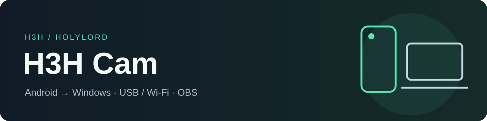

# Your Android phone as a Studio Camera & Microphone for Windows · 5.0.3 CineAtelier Studio

[Русский](README.md) · **English**

**H3H Cam 5.0.3** turns an Android phone into a low-latency camera and 48 kHz microphone for streaming, OBS Studio, video calls and recording. All camera, color and audio controls live on Windows while the phone captures and hardware-encodes video.

[**Download full Portable 5.0.3**](https://github.com/H3H-holylord/H3H-Cam/releases/download/v5.0.3/H3H-Cam-5.0.3-Portable.zip) · [Quick start](docs/QUICKSTART.en.md) · [Report a problem](https://github.com/H3H-holylord/H3H-Cam/issues)

## New in 5.0.3 (CineAtelier Studio)

- **Ultra Low-Latency Windows Decoder (`pipe:0` + `AUD` + `slice`)**: direct RTP → Annex-B depacketizer with Access Unit Delimiter (`AUD`), removing localhost UDP/SDP probing, frame-thread buffering and GPU→CPU readback — cuts average decode latency to **~20 ms** and increases 1080p60 throughput by 4×.
- **Universal Camera1 & Camera2 API Selector + 60 FPS Fix**: choose `Auto`, `Camera2 API` or `Original Camera1 API` on Android and Windows; universal 60 FPS pipeline (clean `SessionConfiguration.sessionParameters`, `KEY_OPERATING_RATE`, `VBR` encoding, Qualcomm `video-hsr`, automatic EIS & idle Face Detection off at 60 FPS while keeping optical OIS).

- **Dual Studio Personas + Mini Controller**: switch on the fly between **Cine Rig** (dark broadcast monitor) and **Nordic Atelier** (warm tactile light mode), or collapse into a compact always-on-top **Mini Controller**.
- **Smart Privacy Slate**: replace live video instantly with a studio card, blurred freeze-frame, custom image or black frame without dropping the stream.
- **Phone Microphone Bridge (48 kHz / 16-bit PCM)**: stream phone audio over USB (ADB TCP), USB Direct (AOA) and Wi-Fi (UDP) with source selection, noise suppression, `-24…+24 dB` gain, `0…500 ms` sync delay, live VU meter, Windows audio output routing and `.mp4` muxing.
- **Cinema Color & Scopes**: `.cube` 3D LUT loader + built-in film looks, live **Waveform / RGB Parade / Histogram** scopes, **False Color** exposure assist and smooth **A↔B Focus Pull**.
- **OBS WebSocket v5 & Multi-Cam**: live ON-AIR Tally border, background scene eco-throttling, audio mute sync, and one-click **Camera #2** multi-instance support with custom Spout2 channel names.
- **Upgraded Wi-Fi Discovery & VPN Bypass**: direct LAN phone discovery via **FIND** without ADB, `TRANSPORT_WIFI` socket binding to bypass active phone VPNs, TCP QR pairing fallback, PC NIC selector and built-in Wi-Fi APK sharing.

## Start here

1. Extract the **entire** Portable ZIP to a folder and run `H3HCam Receiver.exe` (keep `tools` and `models` next to the EXE).
2. Install `H3H-Cam-5.0.3.apk` on your phone and grant **Camera** and **Microphone** permissions (via `Install-on-phone.cmd` over USB or via the built-in Wi-Fi APK QR link).
3. **USB**: select **USB · via ADB → FIND → START**.
   **Wi-Fi (no cable)**: open `H3H Cam 5.0` on the phone on the same LAN, select **Wi-Fi · RTP → FIND → START** (or use **QR Wi-Fi**).
4. Enable **Virtual camera** for OBS, Zoom or Discord, and toggle **🎙️ MIC** to route phone microphone audio.

## Downloads

[Full Portable 5.0.3](https://github.com/H3H-holylord/H3H-Cam/releases/download/v5.0.3/H3H-Cam-5.0.3-Portable.zip) · [Android APK 5.0.3](https://github.com/H3H-holylord/H3H-Cam/releases/download/v5.0.3/H3H-Cam-5.0.3.apk) · [SHA256SUMS.txt](https://github.com/H3H-holylord/H3H-Cam/releases/download/v5.0.3/SHA256SUMS.txt)

**GPL-3.0.** Third-party components retain their own licenses: [THIRD_PARTY.md](THIRD_PARTY.md).

Created by [H3H / HolyLord](https://github.com/H3H-holylord).
