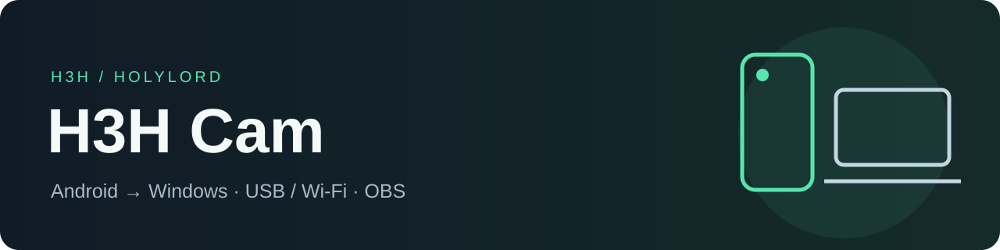

# Камера и микрофон телефона для Windows и OBS · 5.0.3 CineAtelier Studio

**Русский** · [English](README.en.md)

**H3H Cam 5.0.3** превращает Android-телефон в студийную камеру и беспроводной/USB-микрофон для стримов, видеозвонков и записи. Все настройки задаются в Windows-клиенте; смартфон аппаратно кодирует видео (H.264 / HEVC) и передаёт чистый звук 48 кГц.

[**Скачать полный Portable 5.0.3**](https://github.com/H3H-holylord/H3H-Cam/releases/download/v5.0.3/H3H-Cam-5.0.3-Portable.zip) · [Быстрый старт](docs/QUICKSTART.md) · [Сборка](docs/BUILD.md) · [Сообщить о проблеме](https://github.com/H3H-holylord/H3H-Cam/issues)

## Что нового в 5.0.3 (CineAtelier Studio)

- **Ультра-низколатентный декодер Windows (`pipe:0` + `AUD` + `slice`)**: прямой депакетизатор RTP → Annex-B с маркером конца кадра `AUD`, без локального UDP/SDP-хопа, без многокадрового буфера декодера и GPU→CPU readback — средняя задержка декодирования снижена до **~20 мс** (старт в 6.5× быстрее, пропускная способность 1080p60 выросла в 4×).
- **Выбор Camera API (`Авто` / `Camera2 API` / `Оригинальный API (Camera1 / 60 FPS)`) + универсальные 60 FPS**: переключатель на главном экране Android и во вкладке «Камера» Windows-клиента; универсальная поддержка Camera1 (`video-hsr` + `video-hfr`), чистые `SessionConfiguration.sessionParameters` для Camera2, `KEY_OPERATING_RATE` + `VBR` без дропа кадров и ряби, автоматическое отключение EIS и фонового Face Detection при 60 FPS с сохранением OIS.

- **Два характера в одном корпусе + Мини-пульт**: мгновенное переключение между тёмным режиссёрским монитором **«Cine Rig»** и светлым тактильным прибором **«Nordic Atelier»**, а также компактный режим **«Мини-пульт»** поверх окон.
- **Умная шторка приватности (`SmartPrivacySlate`)**: мгновенное закрытие кадра студийной карточкой «СКОРО ВЕРНУСЬ», размытым стоп-кадром, своей заставкой или чёрным полем без обрыва потока в OBS/Zoom.
- **Микрофон смартфона (48 кГц / 16-бит PCM)**: передача звука по USB (ADB TCP), USB Direct (AOA) и Wi-Fi (UDP) с выбором источника (`Voice Comm`, `Camcorder`, `Unprocessed`), аппаратным шумоподавлением, усилением `-24…+24 дБ`, компенсацией задержки `0…500 мс`, живым VU-метром, выводом на любое аудиоустройство Windows (включая Virtual Cable для OBS) и синхронной записью в `.mp4`.
- **Кинокартинка и контроль света**: поддержка 3D LUT `.cube` и встроенных киноплёночных профилей (`Kodak 2383`, `ARRI Warm`, `Nordic Clean`), живые видеоскопы (**Waveform**, **RGB Parade**, **Гистограмма**), **False Color** экспонометрия и плавная переброска фокуса **Focus Pull A↔B**.
- **Автоматизация OBS Studio и Мультикам**: прямая связь по **OBS WebSocket v5** (красная Tally-рамка «В ЭФИРЕ», эко-троттлинг в неактивных сценах, синхронный мьют микрофона) и запуск нескольких камер одновременно (**«Камера #2»** с изолированным профилем, портами и именем канала Spout2).
- **Улучшенный Wi-Fi без ADB и в обход VPN**: фоновый радиомаяк смартфона позволяет находить второй телефон кнопкой **«НАЙТИ»** без кабеля; привязка сокетов к физическому `TRANSPORT_WIFI` обходит активный VPN на телефоне; добавлены TCP-фоллбэк для QR-кода, выбор сетевой карты ПК и раздача APK прямо по Wi-Fi из окна QR.

## Основные возможности

- H.264 / HEVC, разрешение до QHD / 4K, 30/60 FPS и гибкий битрейт (1080p60 проверен на Samsung Note9; режимы зависят от Camera2 и прошивки).
- 2560×1440 (QHD / «2K»): прямой захват либо GPU-уменьшение из большего режима на смартфоне ([подробности](docs/QHD-4.0.11.md)).
- Три транспорта: **USB через ADB**, **Wi-Fi (QR / прямой поиск / RTP)** и **USB Direct (AOA)** при совместимом драйвере WinUSB.
- Встроенная виртуальная камера (`x64/x86` модули уже в архиве), вывод **Spout2** и поток MPEG-TS для OBS.
- AI-размытие/замена фона (`U2Net` DirectML), 4K Super Resolution, автокадрирование по лицу и защита батареи от перегрева.
- Русский и английский интерфейс на ПК и смартфоне без перезапуска потока.

## Скачать

| Файл | Назначение |
|---|---|
| [Полный Portable 5.0.3 — рекомендуется](https://github.com/H3H-holylord/H3H-Cam/releases/download/v5.0.3/H3H-Cam-5.0.3-Portable.zip) | Windows 5.0.3, .NET, FFmpeg/FFplay, ADB с DLL, виртуальная камера, APK 5.0.3 и AI-модель |
| [Android APK 5.0.3](https://github.com/H3H-holylord/H3H-Cam/releases/download/v5.0.3/H3H-Cam-5.0.3.apk) | Android 5.0.3 (Android 8+): Camera1/Camera2 60 FPS, микрофон 48 кГц, Wi-Fi маяк и обход VPN |
| [SHA256](https://github.com/H3H-holylord/H3H-Cam/releases/download/v5.0.3/SHA256SUMS.txt) | Контрольные суммы файлов релиза |

**Новым пользователям: скачайте полный Portable и распакуйте его целиком.** Отдельно устанавливать .NET, FFmpeg, FFplay или ADB не требуется.

## Начать работу

1. Распакуйте весь архив Portable в отдельную папку и запустите `H3HCam Receiver.exe`.
2. Обновите или установите `H3H-Cam-5.0.3.apk` на смартфон и разрешите доступ к **камере** и **микрофону** (по кабелю через `Установить на телефон.cmd` или по Wi-Fi через кнопку скачивания APK внутри окна **«QR Wi-Fi»**).
3. **По кабелю**: выберите **USB · через ADB → НАЙТИ → СТАРТ**.
   **По Wi-Fi (без кабеля)**: откройте `H3H Cam 5.0` на телефоне в одной локальной сети с ПК, выберите **Wi-Fi · RTP → НАЙТИ → СТАРТ** (или нажмите **«QR Wi-Fi»** и отсканируйте код).
4. Включите **«Виртуальная камера»** для OBS, Discord, Zoom и браузеров. Микрофон телефона включается кнопкой **🎙️ MIC** под монитором или на вкладке **«Звук и OBS»**.

Подробная инструкция: [docs/QUICKSTART.md](docs/QUICKSTART.md).

## Ограничения

60 FPS и высокие разрешения зависят от реализации Camera2 и аппаратного кодека конкретного телефона. На смартфонах Vivo / Xiaomi при подключении по Wi-Fi убедитесь, что в системном контроле трафика (*iМенеджер → Управление трафиком → Контроль сети*) приложению `H3H Cam` разрешён доступ к **Wi-Fi**. Wi-Fi и ADB рассчитаны на доверенную домашнюю сеть.

## Разработка и лицензия

`android/` — захват видео/звука и кодек; `windows/` — .NET 8 WPF, студийный пайплайн и вывод; `tests/` — модульные и интеграционные тесты; `docs/` — документация.

**GPL-3.0.** Сторонние компоненты сохраняют свои лицензии: [THIRD_PARTY.md](THIRD_PARTY.md).

Автор: [H3H / HolyLord](https://github.com/H3H-holylord).
